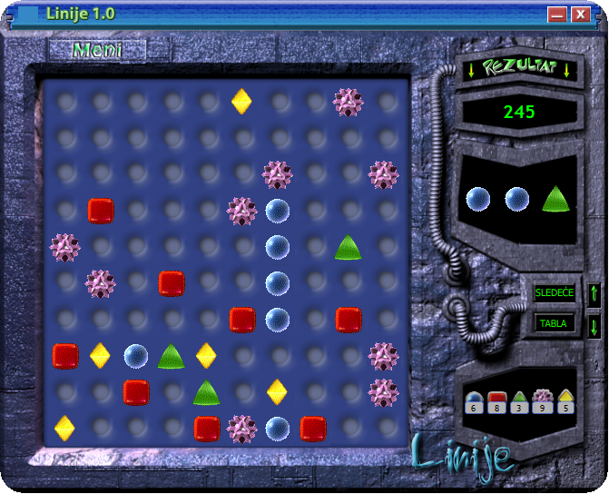
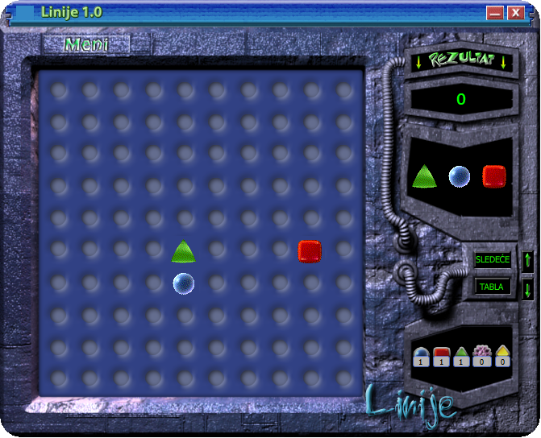
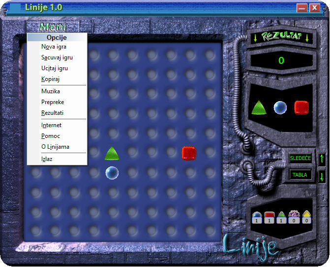
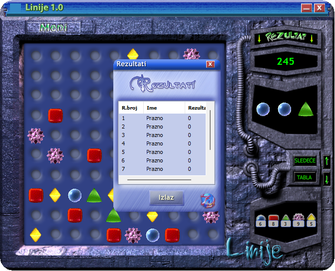

# Linije

A Lines-style puzzle game for Windows, written in C++ and MFC in 2004. The game's interface is in Serbian.



## Download and play

Get the latest version from the [Releases page](https://github.com/milanm/Linije/releases/latest):

- **`Linije-<version>-setup.exe`**: installer. Adds Start menu and optional desktop shortcuts and installs into your user profile, so it doesn't need admin rights.
- **`Linije-<version>-portable.zip`**: no installation. Unzip it anywhere and run `Linije.exe`.

Works on Windows 10 and 11. Nothing else needs to be installed.

The files aren't code-signed, so Windows SmartScreen may show "Windows protected your PC". Click **More info**, then **Run anyway**.

If you use the ZIP and the help (F1) opens blank, right-click the ZIP, choose **Properties**, tick **Unblock**, and extract it again.

## How to play

- The board is 10×10, with five shapes: ball, cube, diamond, triangle and star.
- Click a shape, then click an empty cell. It moves only if there is a free path to that cell (found with A* search).
- Line up 5 or more of the same shape horizontally, vertically or diagonally to clear them. Five gives 100 points, and every extra shape adds 50 more.
- If your move doesn't clear a line, three new shapes appear. The panel on the right shows which ones are coming next. **SLEDEĆE** rerolls them once per move.
- The game ends when the board is full.
- **Meni** has new game, save and load, music, obstacles (adds walls to the board), high scores and help.

| New game | Menu | High scores |
|---|---|---|
|  |  |  |

## Building from source

You need Visual Studio 2022 or newer with the **Desktop development with C++** workload and the **C++ MFC for latest build tools (x86 & x64)** component.

Open `Linije.sln` and build the `Release | x86` configuration, or run this from a Developer Command Prompt:

```
msbuild Linije.sln /p:Configuration=Release /p:Platform=x86
```

The game reads its sounds, music and help file from the folder it runs in, so copy `*.wav`, `Zvuk.mid` and `Linije.chm` next to `bin\Release\Linije.exe`.

GitHub Actions builds the installer and the ZIP on every push. Pushing a `v*` tag publishes them as a release.

## Credits

- Programming: [Milan Milanović](https://www.linkedin.com/in/milanmilanovic/)
- Graphics: [Uroš Pavlović](https://rs.linkedin.com/in/urospavlovic)

---

## Na srpskom

Linije su logička igra za Windows, napisana u C++/MFC-u 2004. godine. Poslednju verziju preuzmite sa [stranice Releases](https://github.com/milanm/Linije/releases/latest): instaler (`setup.exe`) ili ZIP koji samo raspakujete i pokrenete `Linije.exe`. Radi na Windows 10 i 11, bez administratorskih prava.

Cilj je da poređate 5 ili više istih figura u liniju (vodoravno, uspravno ili dijagonalno). Figura se pomera samo ako do izabranog polja postoji slobodan put. Posle svakog poteza koji ne napravi liniju pojavljuju se tri nove figure, a igra se završava kada se tabla popuni.

Programiranje: [Milan Milanović](https://www.linkedin.com/in/milanmilanovic/). Grafika: [Uroš Pavlović](https://rs.linkedin.com/in/urospavlovic).
